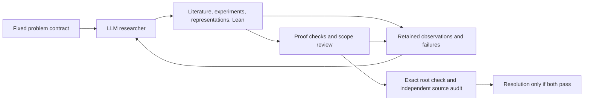

# math_gkm: mathematical research with explicit proof boundaries

`math_gkm` is a machine-authored mathematical research experiment in the
**Gödel–Kolmogorov Machine (GKM)** lineage. A general LLM researcher chooses
representations, reads literature, runs experiments and develops Lean proofs;
retained records and independent review distinguish what was proposed, executed,
compiled, replayed and actually proved. The fixed [mission](MISSION.md) and
[design](docs/DESIGN.md) govern the project.

## Concept-driver revision

The [concept-directed loop](docs/CONCEPT_DRIVER.md) connects source-review
diagnoses to subsequent proposals, reserves multi-round conceptual investigations
alongside ordinary proof work, and evaluates the resulting library package on
fixed independent obligations. Invalid comparisons remain inconclusive.
Complexity stays audit-only; typed gluing and exact Lean admission remain separate
from empirical research usefulness. This is an operator-engineered revision, not
a certified Goedel self-improvement. The dated launch records preserve its tests,
review, clean-seed comparison and actual activation status.

**Clean-seed concept campaign, through round 35 on 21 October 2026:** 35
independently admitted results. All three original weak log-concavity directions
are now proved for every constant-left path of length `k >= 0`, with midpoint
label `(1, k + 2)`, at every index satisfying the original polygon conditions.
The coefficients remain raw integers, including zeros; the proof uses the
previously admitted exact coefficient formula. A checked conditional reduction
restricts the remaining interior obligation to paths containing at least one
right turn.

Two new universal structural bundles cover every constant-right path of length
`k >= 0`, with midpoint label `(k + 1, k + 2)`. For its actual midpoint polynomial
`M_k` and `T = U + V`, they prove the recurrence
`M_(k+2) = T(T+1) M_(k+1) - UV M_k`, exact coefficient-array recovery and
coefficient nonnegativity, and a homogeneous substitution giving every
total-degree layer. These structural bundles establish no additional
log-concavity inequality.

Round 32 adds two independently admitted lemmas. For all natural `1 <= h <= n`,
the sequence `binom(h+s,h) binom(n-s-1,h-1)` on `0 <= s <= n-h`, extended by
zero outside that interval, is nonnegative, has no internal zeros and is
log-concave. The second lemma is general: if the degree-`m` layer of an integer
bivariate polynomial is `(U+V)^b R`, where `m=b+r`, `R` is homogeneous of degree
`r`, and the coefficients of `R(U,1)` are nonnegative, have no internal zeros
and are log-concave, then that layer satisfies the antidiagonal log-concavity
inequalities.

Round 34 composes these results to prove the original antidiagonal inequality
for every constant-right path of length `k >= 0`, with midpoint label
`(k + 1, k + 2)`. For every natural `i,j`, if the three points `(i,j+2)`,
`(i+1,j+1)` and `(i+2,j)` satisfy the original polygon conditions, its actual
midpoint polynomial satisfies `c(i,j+2)c(i+2,j) <= c(i+1,j+1)^2`, including raw
zero coefficients. This supplies no new horizontal or vertical inequality for
that family, no arbitrary-path result and no discharge of a root obligation.

Round 35 adds a checked conditional reduction to the previous true-path
interior obligation. Its new residual still requires horizontal inequalities
with `j > 0` and vertical inequalities with `i > 0` for every path containing
`true`, with all three original polygon premises in each direction. It requires
antidiagonal inequalities only for paths also containing `false`, with the
original strict degree guard `i+j+2 < E.a+E.b-1` and all three polygon premises,
where `E` is the path's actual midpoint entry, with label `(E.a,E.b)`. These are
open hypotheses of the
reduction, not newly proved inequalities. The admitted constant-right theorem
supplies the all-`true` diagonal cases. The new residual, previous residuals and
root remain open. **Full Conjecture 6.3 remains open**.

The [canonical accepted checkpoint](evidence/accepted-checkpoint-20261020.tar.gz)
preserves original proof sources, checked receipts, dependency pins and separately
bound exported declarations. Its top-level `MANIFEST.json` identifies the latest
accepted registry and checked proposition DAG through `current_checkpoint`;
earlier snapshot payloads retain their original bytes and provenance. The V3 and
older campaign results below have their own dated scope.

## Blended strategy V3

The latest fresh Lean verification covers every polynomial in the numerator-one
branch, in all three coefficient directions and at every admissible triple.
The general Markov conjecture remains open. See the
[exact result and current comparison status](STRATEGY_V3_RELEASE.md#fresh-verification-of-the-numerator-one-family);
the older campaign results below remain historical.

The combined harness keeps ordinary theorem development as its default. The
researcher can also investigate a consequential uncertainty, change a
representation, or test a research strategy. Typed interfaces and checked
gluing/transport laws support reuse. Matched continuation trials can return
researcher-discovered facts to the main run through fresh, paid proof checks,
including facts from a strategy that was not selected. Outcomes can change the
next actual request. Complexity and supported proof-route descriptions remain
one-way audit observations; they do not select actions or reward theorem counts.

Separate external Codex invocations using `gpt-6.1-sol` with high reasoning
constructed V3. Independent reviews and real Lean acceptance checks distinguish
source inspection, compilation, kernel replay, premise inspection, composition
and autonomous strategy execution. See the [V3 acceptance and comparison record](STRATEGY_V3_RELEASE.md)
for exact versions, outcomes and limits. Neutral fixture proofs are known
integration examples, not Markov discoveries. Concrete whole-host continuation,
refinement and certified installation obligations D1/D2/D3 remain open.

The user authorized a fresh Markov comparison after acceptance testing. Both
arms start with identical clean definitions, dependency pins, model and upper
allowances, without inherited campaign proofs or agendas. Exploitation uses a
revisable agenda; the combined arm also has optional exploration and tested
strategy reassessment. Report observed mathematical scope, actual checked reuse,
strategy decisions and costs; one sequential pair does not establish causal
superiority. The supervising session supplies no mathematical proof strategy.

The original campaign is stopped at worker 209. Research-status material below
is historical. The [V2 release](STRATEGY_V2_RELEASE.md) and its dated evidence
remain preserved; its test counts are not relabeled as V3 runs.

**Research status, through closed worker 188 (17 October 2026):** the Agoh
exercise is complete. For Markov polynomials, every numerator-two source has
all three raw-coefficient log-concavity directions at all natural indices.
Every numerator-three source has horizontal log-concavity throughout the
lower half-plane and in upper rows satisfying the explicit linear bound,
including zeros. Earlier rows and additional strict column regions are also
proved, including the single upper-row triple at columns 4, 5 and 6 under
its stated depth conditions. **Full Conjecture 6.3 remains open.** See the
dated [research status and exact remaining scope](RESEARCH_STATUS.md) for the
precise domains, residual obligations and validation limits.

## The three ideas behind the name and architecture

| Idea | What is present here | Boundary |
| --- | --- | --- |
| **Gödel machine** | A checked Lean model compares a guarded engine change with the entire incumbent continuation, including later searches and installations. | This does not certify arbitrary Python, LLM or operating-system edits. The live research controller is experimental. |
| **Kolmogorov perspective** | Description, dependency and reuse evidence can be audited separately from mathematical success. | True Kolmogorov complexity is uncomputable. Complexity is audit-only: no curiosity reward, action-selection score or theorem-count objective. |
| **Gluing / cofibrant construction** | Lean proves a pushout universal property for types, a concrete glued-state equivalence, and conditional conservative attachment/transport theorems. | No model category, cofibration structure or automatic conservative linker for dependent Lean modules is implemented. |

Read [Gödel machines, complexity and the actual research loop](docs/GKM.md) and
[gluing: mathematics, witnesses and implementation limits](docs/GLUING.md).
These pages separate proved interfaces from the broader design vocabulary.

The proposer has general research actions within its granted tools and resource
limits. The supervisor supplies the problem and reviews evidence, rather than
supplying a proof recipe. Ordinary exploration does not require a proof that each
next action is optimal. A theorem about a mathematical claim, a proof of a model
switch, and permission to edit the host controller are three different things.

## Reading the repository

- [Current research scope](RESEARCH_STATUS.md), with exact source links and
  evidence limits; [Agoh account](docs/round2/AGOH.md) for the completed exercise.
- [Construction mathematics](docs/CONSTRUCTION_MATHEMATICS.md) for the precise
  continuation theorem and counterexamples to missing assumptions.
- [Controller](docs/CONTROLLER.md) for live transport, durable recovery, resource
  accounting and the independent completion boundary.
- [Original construction checkpoint](docs/CONSTRUCTION.md),
  [initial Markov account](docs/round2/MARKOV.md) and
  [attempt log](docs/ATTEMPTS.md) for historical stages. Their dated status
  statements are not the current frontier.
- [Checkpoint](RESUME.json), `research/` sources, `evidence/` receipts and
  controller-retained worker records for provenance. A file's existence or a
  worker's successful exit does not alone establish mathematical acceptance.

Use the [portable reproduction and recovery tools](repro/README.md) to create a
separate workspace with exact source and dependency pins. Fresh construction,
Agoh and initial Markov compilation and kernel replay have passed using the
existing pinned dependencies. A cold dependency bootstrap and the whole later
campaign have not been rebuilt by that check. The historical wrappers and their
environment-specific paths remain preserved.

Sources, scripts, inputs, dependency pins and recovery manifests stay in Git.
Large optional compilation caches are archived as checksum-verified
[GitHub Release assets](https://github.com/sashakolpakov/math_gkm/releases/tag/recovery-cache-2026-10-17);
`git clone` does not download those assets. The recovery tool downloads them
explicitly. Local cache cleanup must never remove necessary public source/data
history or turn into a Git deletion commit. Ordinary `.olean` and `.lake` build
caches remain untracked; explicitly sealed binary evidence keeps its recorded
historical status.

## Public evidence provenance

The [public repository](https://github.com/sashakolpakov/math_gkm) exports a
filtered history: one expired publisher-PDF URL query was removed from a
historical worker58 trace. The original local history is retained. Historical
audit hashes identify those original local records; the redacted trace is a
derivative record, not hash-identical evidence. No Lean source was changed by
this filtering, and it adds no mathematical or verification claim.
