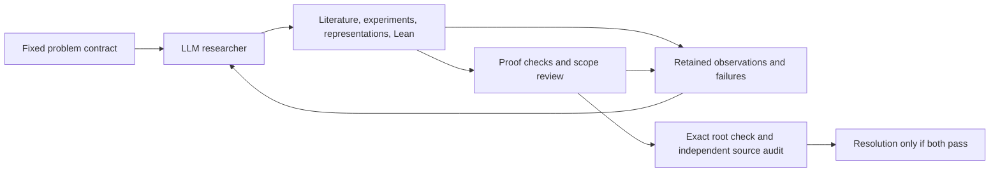

# math_gkm: mathematical research with explicit proof boundaries

`math_gkm` is a machine-authored mathematical research experiment in the
**Gödel–Kolmogorov Machine (GKM)** lineage. A general LLM researcher chooses
representations, reads literature, runs experiments and develops Lean proofs;
retained records and independent review distinguish what was proposed, executed,
compiled, replayed and actually proved. The fixed [mission](MISSION.md) and
[design](docs/DESIGN.md) govern the project.

**Research status, through closed worker 181 (17 October 2026):** the Agoh
exercise is complete. For Markov polynomials, all three raw-coefficient
log-concavity directions are proved at all natural indices for every
numerator-two source. Every numerator-three source has horizontal
raw-coefficient log-concavity for all natural column and row indices `i, j`
satisfying `2*j + 1 ≤ b`, where `b` is the source denominator, including zeros
and both denominator residues. The earlier lower-region, correction-row and
`j = 5` results remain in force. **Full Conjecture 6.3 remains open.** See
the dated [research status and exact remaining scope](RESEARCH_STATUS.md).

## The three ideas behind the name and architecture

| Idea | What is present here | Boundary |
| --- | --- | --- |
| **Gödel machine** | A checked Lean model compares a guarded engine change with the entire incumbent continuation, including later searches and installations. | This does not certify arbitrary Python, LLM or operating-system edits. The live research controller is experimental. |
| **Kolmogorov perspective** | Description, dependency and reuse evidence can be audited separately from mathematical success. | True Kolmogorov complexity is uncomputable. Complexity is audit-only: no curiosity reward, action-selection score or theorem-count objective. |
| **Gluing / cofibrant construction** | Lean proves a pushout universal property for types, a concrete glued-state equivalence, and conditional conservative attachment/transport theorems. | No model category, cofibration structure or automatic conservative linker for dependent Lean modules is implemented. |

Read [Gödel machines, complexity and the actual research loop](docs/GKM.md) and
[gluing: mathematics, witnesses and implementation limits](docs/GLUING.md).
These pages separate proved interfaces from the broader design vocabulary.

The proposer has general research actions within its granted tools and resource
limits. The supervisor supplies the problem and reviews evidence, rather than
supplying a proof recipe. Ordinary exploration does not require a proof that each
next action is optimal. A theorem about a mathematical claim, a proof of a model
switch, and permission to edit the host controller are three different things.

## Reading the repository

- [Current research scope](RESEARCH_STATUS.md), with exact source links and
  evidence limits; [Agoh account](docs/round2/AGOH.md) for the completed exercise.
- [Construction mathematics](docs/CONSTRUCTION_MATHEMATICS.md) for the precise
  continuation theorem and counterexamples to missing assumptions.
- [Controller](docs/CONTROLLER.md) for live transport, durable recovery, resource
  accounting and the independent completion boundary.
- [Original construction checkpoint](docs/CONSTRUCTION.md),
  [initial Markov account](docs/round2/MARKOV.md) and
  [attempt log](docs/ATTEMPTS.md) for historical stages. Their dated status
  statements are not the current frontier.
- [Checkpoint](RESUME.json), `research/` sources, `evidence/` receipts and
  controller-retained worker records for provenance. A file's existence or a
  worker's successful exit does not alone establish mathematical acceptance.

The historical bootstrap checks are described in the construction/controller
pages. With the supplied pinned dependencies, `python3 -m machinery.check`
runs bounded construction checks, and `python3 evidence/markov/reproduce.py`
reproduces the initial Markov experiments. Neither command validates the entire
later campaign. Ordinary working `.olean` caches and `.lake` dependencies are
intentionally untracked. Explicitly sealed partial-evidence copies may be retained
and carry only their recorded validation status. A public clone needs the compatible pinned Lean/Mathlib
setup; retained commands also contain environment-specific library paths. There
is no advertised one-command fresh rebuild of every later research result.
Consult the recorded commands and import/validation scope for a particular result.
No build or experiment is needed merely to read these documents.

## Public evidence provenance

The [public repository](https://github.com/sashakolpakov/math_gkm) exports a
filtered history: one expired publisher-PDF URL query was removed from a
historical worker58 trace. The original local history is retained. Historical
audit hashes identify those original local records; the redacted trace is a
derivative record, not hash-identical evidence. No Lean source was changed by
this filtering, and it adds no mathematical or verification claim.
